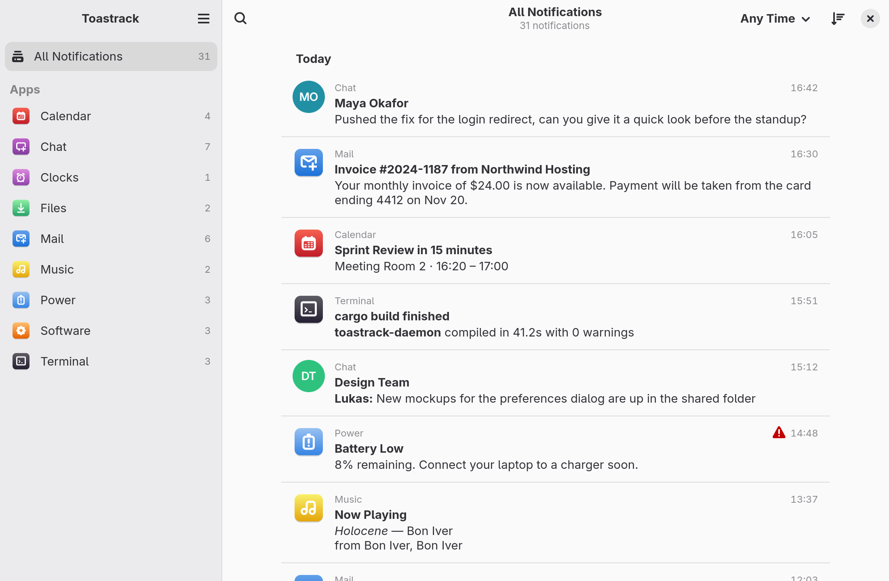
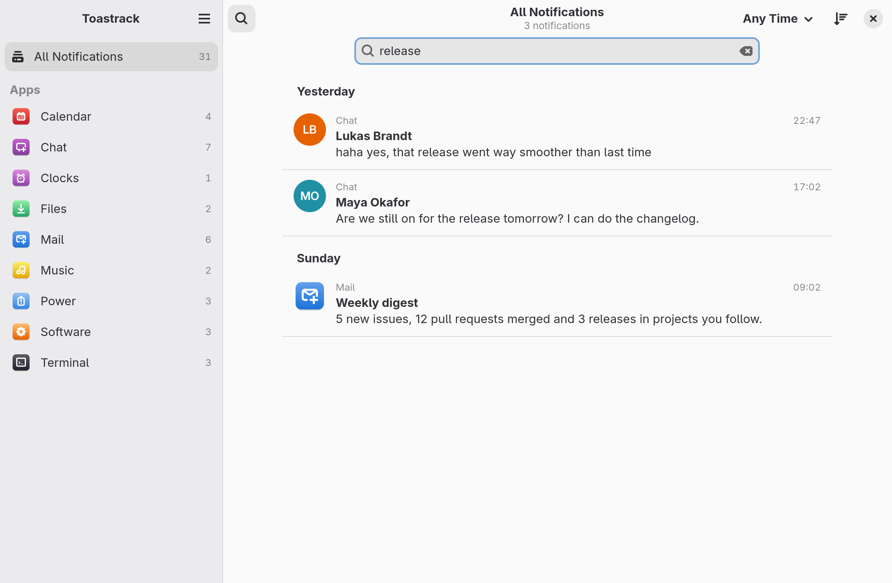
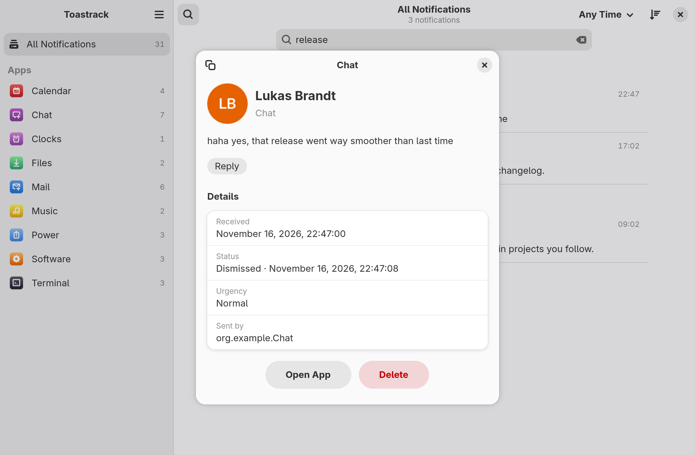

# Toastrack

Browse and search the history of your desktop notifications.

Toastrack keeps every notification you get, so you can find the ones you
missed or dismissed too quickly. List them by day or app, filter by date and
urgency, and search their contents. Everything stays on your computer.

<picture>
  <source media="(prefers-color-scheme: dark)" srcset="data/screenshots/main-dark.png">
  
</picture>

<table>
  <tr>
    <td>
      <picture>
        <source media="(prefers-color-scheme: dark)" srcset="data/screenshots/search-dark.png">
        
      </picture>
    </td>
    <td>
      <picture>
        <source media="(prefers-color-scheme: dark)" srcset="data/screenshots/detail-dark.png">
        
      </picture>
    </td>
  </tr>
</table>

It has two parts:

- **`toastrack-daemon`**, a small Rust service (systemd user unit
  `toastrack.service`) that records notifications into SQLite.
- **Toastrack**, a GTK 4 / libadwaita app in Vala for browsing the history.

Linux, Wayland and x86_64 only.

## How notifications are recorded

The daemon doesn't replace or proxy your notification server (mako, dunst,
swaync, GNOME Shell, KDE Plasma…). It becomes a passive
[D-Bus monitor](https://dbus.freedesktop.org/doc/dbus-specification.html#bus-messages-become-monitor)
of the session bus and receives *copies* of:

- `org.freedesktop.Notifications.Notify` calls, and the server's replies
  carrying the id it assigns
- `NotificationClosed` and `ActionInvoked` signals
- `org.gtk.Notifications` calls (GNOME's GApplication notifications)

A monitor can't send messages or delay them, so it can't interfere with how
notifications are shown. Flatpak apps' portal notifications are recorded as
the portal backend forwards them to one of the interfaces above.

Notifications that replace one another (`replaces_id`) update the same entry
when they come within 30 seconds, or are progress-style updates; later
replacements are kept as separate entries so e.g. chat messages aren't lost.

The history lives in `~/.local/share/toastrack/history.db`, with full-text
search via FTS5. The daemon owns the schema
([`daemon/src/schema.sql`](daemon/src/schema.sql)); the app reads it and can
delete notifications, and both share settings such as the retention period.
The daemon emits `Added` / `Changed` signals on
`io.github.jonnsl.Toastrack1` so the app updates live.

## Building

Dependencies: `meson`, `valac`, `blueprint-compiler`, `cargo`,
`gtk4 >= 4.18` (with the Wayland backend), `libadwaita-1 >= 1.8`, `sqlite3`.

```sh
meson setup build -Dprofile=development
ninja -C build
meson test -C build   # Rust and Vala tests, desktop file and schema validation
```

Run it uninstalled:

```sh
./build/daemon/toastrack-daemon &
GSETTINGS_SCHEMA_DIR=build/data ./build/src/toastrack
```

### Installing

```sh
meson setup build --prefix=/usr
ninja -C build
sudo meson install -C build
systemctl --user enable --now toastrack.service   # or "Start Recording" in the app
```

### Arch Linux

```sh
cd build-aux/arch
makepkg -si
```

### Code style

Vala sources are formatted with [Uncrustify](https://github.com/uncrustify/uncrustify)
and checked with [vala-lint](https://github.com/vala-lang/vala-lint); the daemon
with `cargo fmt` and `cargo clippy`. CI runs all of them.

```sh
build-aux/check-style.sh         # check
build-aux/check-style.sh --fix   # reformat in place
```

## License

GPL-3.0-or-later. See [COPYING](COPYING).
